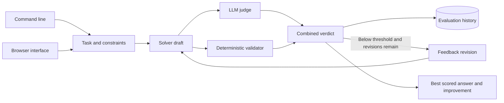

# Self Reflective Agent

## About

This app gives a model a chance to improve an answer before returning it. It drafts a response, checks that response against your instructions and a judge model, then revises it a limited number of times. It keeps the best version and saves the scores from each run so you can see whether revisions helped.

### What you can do

- Give a task with constraints such as a required phrase or format.
- Apply deterministic checks for rules that must be followed exactly.
- Inspect the first answer, revisions, judge feedback, and final score.
- Review saved metrics across runs from the CLI or local browser.

The CLI, local browser, and Python library work with a configured model provider. A judge score is an internal signal and can be mistaken, so use a separate evaluation set before claiming real quality improvement. The product has no public hosted URL yet.

## Quick start

Requires Python 3.11 or newer. From this repository:

```powershell
python -m venv .venv
.\.venv\Scripts\Activate.ps1
python -m pip install -e '.[dev]'
pytest -q
```

On macOS or Linux:

```bash
python3 -m venv .venv
source .venv/bin/activate
python -m pip install -e '.[dev]'
pytest -q
```

For live model calls, set `OPENAI_API_KEY` and optionally `OPENAI_MODEL` and `OPENAI_BASE_URL` as shown in `.env.example`. The test suite uses stubs and needs no model key.

The installed `reflect-agent` command runs a real solver/judge loop. Example: `reflect-agent --db evaluations.sqlite3 --solver-model model-a --judge-model model-b reflect "Write an incident summary" --constraint "Include next steps" --must-include "next steps"`. `reflect-agent --db evaluations.sqlite3 metrics` reads persisted scores without a model key. Run `reflect-agent --db evaluations.sqlite3 serve --port 8080` to use the local browser. Required phrases are checked deterministically; the judge score is an internal signal, not a substitute for held out evaluation.

```python
from self_reflective_agent.engine import SelfReflectiveAgent
from self_reflective_agent.llm import OpenAICompatibleLLM

llm = OpenAICompatibleLLM.from_env()
agent = SelfReflectiveAgent(llm, llm, "eval.sqlite3", threshold=0.85, max_revisions=2)
result = agent.run("Write a migration checklist", constraints=["Use no more than five steps"])
print(result.answer, result.history, agent.metrics())
```

## Architecture



| Component | Responsibility |
|---|---|
| Solver | Produces and revises answers under explicit constraints. |
| Evaluation gate | Combines typed judge feedback with deterministic violations. |
| History | Stores each revision and reports best-over-first improvement. |

Task and constraints -> solver -> JSON judge verdict -> durable metric -> bounded revision -> best answer.

See [ARCHITECTURE.md](ARCHITECTURE.md) for components, state, failure behavior, and operations.

## Deployment and safety

See [DEPLOYMENT.md](DEPLOYMENT.md) for the non-root container, token-protected browser, data mounts, and release checks.

LLM-as-judge scores are subjective and can be gamed. Use a separate judge model and a held out evaluation set before treating score changes as real quality improvement.

Install this as a library in an authenticated application or worker. Supply the LLM adapter through dependency injection. Keep secrets in environment variables, never in source control.

## Verification

`pytest -q` runs deterministic tests. GitHub Actions runs the same suite on pushes and pull requests.

## License

MIT. See [LICENSE](LICENSE).
